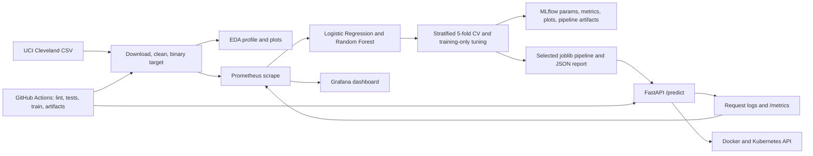

# Heart Disease MLOps: UCI Cleveland classifier

A reproducible, end-to-end MLOps implementation for the AIMLCZG523 Assignment 01. It downloads the original Cleveland dataset from UCI, profiles it, evaluates baseline and tuned classifiers, tracks experiments, packages a preprocessing/model pipeline, tests a FastAPI prediction service, and provides CI, Docker, Kubernetes, and monitoring configurations.

> **Responsible use:** this is an educational model on a small historical dataset, not a clinical diagnostic or treatment tool. Do not use it for patient care or make medical decisions from its scores.

## Architecture



## Prerequisites

- Python 3.11 or 3.12; Docker Desktop with Compose for container work.
- `kubectl` and a local Kubernetes cluster such as Docker Desktop Kubernetes or Minikube for the local deployment.
- Git for Windows if you want to publish the repository and run GitHub Actions.
- Network access to the UCI dataset URL for first-time download and Docker image build.

The project supports Python 3.11 and 3.12. In VS Code select the project `.venv` interpreter after setup.

On Windows, install Python 3.12 with `winget install --id Python.Python.3.12 -e` if needed. Install Docker Desktop from [docker.com/products/docker-desktop](https://www.docker.com/products/docker-desktop/) and enable Kubernetes in Docker Desktop settings, or follow the [Minikube start guide](https://minikube.sigs.k8s.io/docs/start/) and the [official kubectl install guide](https://kubernetes.io/docs/tasks/tools/install-kubectl-windows/). Install Git for Windows with `winget install --id Git.Git -e` if you plan to publish the project or use GitHub Actions. Restart the terminal after installing tools, then confirm `py -0p`, `docker --version`, and `kubectl version --client`.

## Install and run locally (PowerShell)

Run from the project root:

```powershell
py -3.12 -m venv .venv
.\.venv\Scripts\Activate.ps1
python -m pip install --upgrade pip
python -m pip install -r requirements.txt
```

If PowerShell blocks environment activation, either permit it for this terminal with `Set-ExecutionPolicy -Scope Process -ExecutionPolicy Bypass` and activate again, or call `.venv\Scripts\python.exe` instead of activating.

If PowerShell says project scripts are disabled, allow scripts only in the current terminal (this does not change the machine-wide policy):

```powershell
Set-ExecutionPolicy -Scope Process -ExecutionPolicy Bypass -Force
```

This process-scoped setting applies only to the current PowerShell window. It does not permanently change your machine's execution policy.

Download the source, clean it, create EDA and train/track the models:

```powershell
python -m src.data
python -m src.eda
python -m src.train
```

The data loader also downloads the default dataset automatically when needed. `src.data` keeps the raw UCI file under `data/raw/` and writes the cleaned data to `data/processed/heart_disease.csv`. The cleaned CSV, trained model, training summary, EDA figures, and model evaluation plots are retained as reproducible assignment outputs; raw downloads and MLflow database/runtime logs stay local.

Inspect the report/plots and launch the tracker:

```powershell
Get-Content artifacts\dataset_profile.json
Get-Content artifacts\training_summary.json
python -m mlflow ui --backend-store-uri sqlite:///./mlflow.db --host 127.0.0.1 --port 5000
```

Open `http://127.0.0.1:5000` for the **heart-disease-uci** experiment. Runs are stored in the local `mlflow.db` SQLite database. Four independent runs compare Logistic Regression and Random Forest baselines with their tuned variants. The stratified holdout set remains outside tuning; the final pipeline is selected by mean five-fold training-set ROC-AUC. Every run logs parameters, cross-validation and holdout metrics, model artifacts, and ROC/confusion-matrix plots. Model/data split seeds and selection criteria are in `artifacts/training_summary.json`.

Run lint/tests, then start the API:

```powershell
python -m ruff check .
python -m pytest
python -m uvicorn src.api:app --reload --host 127.0.0.1 --port 8000
```

Update `REPORT.md` with the measured results and evidence from your local run before submission. This project uses the Markdown report; generated DOCX output is not included.

Open `http://127.0.0.1:8000/docs` for interactive API documentation. In a second terminal:

```powershell
Invoke-RestMethod http://127.0.0.1:8000/health
$body = @{
  age=63; sex=1; cp=1; trestbps=145; chol=233; fbs=1; restecg=2
  thalach=150; exang=0; oldpeak=2.3; slope=3; ca=0; thal=6
} | ConvertTo-Json
Invoke-RestMethod -Method Post -Uri http://127.0.0.1:8000/predict `
  -ContentType "application/json" -Body $body
Invoke-RestMethod http://127.0.0.1:8000/metrics
```

`/predict` responds with the binary prediction, human-readable label, predicted-class confidence, and positive-class probability. `/metrics` exposes request counters for Prometheus; request logs intentionally omit request bodies and patient input.

Convenience script: `.\scripts\run_local.ps1` (all steps), or choose `-Step data`, `eda`, `train`, `test`, or `api`.

## Prometheus and Grafana (Docker Compose)

Compose starts the API, Prometheus, and Grafana together. Choose a unique local Grafana password before launching. The Compose default is for local-only use; do not expose it on a shared or public machine.

```powershell
$securePassword = Read-Host "Choose a local Grafana admin password" -AsSecureString
$passwordPointer = [Runtime.InteropServices.Marshal]::SecureStringToBSTR($securePassword)
try {
  $env:GRAFANA_ADMIN_PASSWORD = [Runtime.InteropServices.Marshal]::PtrToStringBSTR($passwordPointer)
} finally {
  [Runtime.InteropServices.Marshal]::ZeroFreeBSTR($passwordPointer)
  $securePassword.Dispose()
}
docker compose up --build -d
docker compose ps
```

Wait for the API to become healthy, then generate a few requests using the `/health`, `/predict`, and `/metrics` commands above. Prometheus scrapes the API every 15 seconds. Check all endpoints and target health:

```powershell
.\scripts\verify_deployment.ps1
```

Open Grafana at `http://127.0.0.1:3000`, sign in as `admin` with the password you chose, and select **Dashboards → MLOps Assignment → Heart Disease API Monitoring**. The dashboard shows scrape health, total requests, and request rate per path/status. Open Prometheus at `http://127.0.0.1:9090/targets` and confirm the `heart-disease-api` target is **UP**. API logs are available with `docker compose logs heart-api`.

All monitoring ports are bound to loopback for local access. If port 8000 is already in use by the local API, keep it running and choose a different host port before starting Compose:

```powershell
$env:API_PORT = "18000"
docker compose up --build -d
.\scripts\verify_deployment.ps1 -ApiUrl http://127.0.0.1:18000
```

Stop the stack with `docker compose down`. To also remove local Grafana and Prometheus history, run `docker compose down -v`.

## Docker: isolated build and sample request

The Docker build downloads/trains in a builder stage and copies only the runtime dependencies and joblib model into a non-root API image. `requirements-build.txt` adds the plotting package needed to train in that stage; MLflow is only imported for tracked host training and is not needed in the container:

```powershell
docker compose build
docker compose up -d
docker compose ps
Invoke-RestMethod http://localhost:8000/health
Invoke-RestMethod -Method Post -Uri http://localhost:8000/predict `
  -ContentType "application/json" -Body $body
Invoke-RestMethod http://localhost:8000/metrics
docker compose down
```

The Compose service uses a read-only root filesystem, dropped capabilities, and a non-root user. On a first build, allow time and network access for pip and UCI. If the build reports a transient source or package-index issue, retry and retain the full build logs as evidence.

## Kubernetes: local lab deployment

Build an image with the exact name used by the manifest. With Docker Desktop Kubernetes, it shares Docker's local image store:

```powershell
docker build -t heart-disease-api:local .
kubectl config current-context
```

Create a local Grafana password Secret with a hidden prompt. The helper pipes the Secret manifest directly to `kubectl`; it does not save the password in a project file. Then apply the API and monitoring stack:

```powershell
.\scripts\create_grafana_secret.ps1
kubectl apply -k k8s
kubectl rollout status -n heart-disease-mlops deployment/heart-disease-api --timeout=180s
kubectl rollout status -n heart-disease-mlops deployment/prometheus --timeout=180s
kubectl rollout status -n heart-disease-mlops deployment/grafana --timeout=180s
kubectl get pods,services -n heart-disease-mlops
```

If `docker-desktop` shows only one API replica ready for a short time, wait for the rollout; the API deployment asks Kubernetes for two replicas. If port forwarding reports that a local port is already in use, use an unused host port such as `18000:80` for the API (and set `-ApiUrl http://127.0.0.1:18000` when running the verification script).

For Minikube, make the image available to its daemon before applying manifests:

```powershell
minikube image load heart-disease-api:local
minikube service heart-disease-api -n heart-disease-mlops --url
```

For Docker Desktop, forward the service locally and run the same health/predict/metrics requests:

```powershell
kubectl port-forward -n heart-disease-mlops service/heart-disease-api 8000:80
```

In two more terminals, forward Prometheus and Grafana:

```powershell
kubectl port-forward -n heart-disease-mlops service/prometheus 9090:9090
```

```powershell
kubectl port-forward -n heart-disease-mlops service/grafana 3000:3000
```

With those forwards running, open Grafana at `http://127.0.0.1:3000` (user `admin`, using the password from the Secret) and Prometheus at `http://127.0.0.1:9090/targets`. The Grafana dashboard is provisioned at **Dashboards → MLOps Assignment → Heart Disease API Monitoring**. Generate API traffic and verify API, scrape, and Grafana health:

```powershell
.\scripts\verify_deployment.ps1
```

The API manifest requests a `LoadBalancer`; local clusters may show `<pending>`, which is expected—use port-forward or Minikube's service tunnel. Prometheus and Grafana stay ClusterIP services and are accessed by port-forward. These commands expose local endpoints only; they do not create a public API URL. Inspect logs and clean up:

```powershell
kubectl logs -n heart-disease-mlops deployment/heart-disease-api
.\scripts\cleanup_local_k8s.ps1
```

The cleanup helper targets only the dedicated `heart-disease-mlops` namespace. If a local LoadBalancer has no external IP and Kubernetes leaves its service-cleanup finalizer pending, the helper removes that finalizer only after confirming the API Service has no external address. If local port 8000 is occupied, forward the API to 18000 instead and pass `-ApiUrl http://127.0.0.1:18000` to the verification script.

`monitoring/` configures the Docker Compose Prometheus and Grafana stack. `k8s/kustomization.yaml` provisions equivalent Prometheus and Grafana services, scrape configuration, datasource, and dashboard alongside the API. These configurations are intended for a local assignment demo and are not a hardened internet-facing monitoring service.

## CI/CD and evidence

`.github/workflows/ci.yml` runs on push, pull request, and manual dispatch. It installs dependencies on Python 3.11 and 3.12, runs Ruff and Pytest, downloads/prepares the data, generates EDA, trains/tracks all model candidates, and uploads reports/data/MLflow outputs even when a later step fails. CI training runs on GitHub-hosted runners; download the uploaded run artifacts to inspect its model outputs or MLflow database locally.

There is no automated CD workflow. GitHub-hosted Actions runners cannot access your local Docker Desktop or Minikube cluster; deploy manually from your workstation using the local Kubernetes instructions above.

Record original screenshots under [screenshots/README.md](screenshots/README.md), showing your actual local/lab runs. The instructions require a short overall-pipeline video: record your own end-to-end run (for example, data/EDA → MLflow → tests/CI → Docker API → local Kubernetes/metrics) using your institution-approved screen recorder; no recording is fabricated or included here.

## Report and deliverables

- [`REPORT.md`](REPORT.md): project-specific methods, limitations, and report outline. Replace the marked run-specific placeholders using generated results.
- `artifacts/`: EDA figures, dataset profile, run metrics/plots, final training summary.
- `models/heart_disease.joblib`: final scikit-learn preprocessing + estimator pipeline.
- `monitoring/` and `k8s/monitoring/`: Prometheus scrape configs and the provisioned Grafana dashboard/datasource.
- `mlflow.db`: local MLflow experiment history (ignored by Git).
- `screenshots/`: evidence checklist; capture the screenshots yourself.
- [`scripts/verify_deployment.ps1`](scripts/verify_deployment.ps1): verifies API readiness/prediction/metrics, Prometheus target health, and Grafana health after Compose or Kubernetes port-forwarding.
- [`scripts/cleanup_local_k8s.ps1`](scripts/cleanup_local_k8s.ps1): removes only the project's Kubernetes namespace and handles a pending local LoadBalancer cleanup finalizer safely.

For the Docker API alone you do not need to install training dependencies into your host environment; the image builds the model in a controlled builder stage. For Kubernetes you additionally need a running cluster and a reachable/loadable image. Public cloud deployment, repository publication, screenshots, and video require your own account and actions.

## Publish to your own GitHub repository (optional, required for CI evidence)

Install Git for Windows if needed, create an empty repository under your GitHub account, then run these commands from the project root (replace the URL with your repository):

```powershell
git init
git add .
git commit -m "Implement Heart Disease MLOps assignment"
git branch -M main
git remote add origin https://github.com/<your-user>/<your-repository>.git
git push -u origin main
```

The generated cleaned CSV is included as `data/processed/heart_disease.csv`; raw downloads, trained models, local experiment databases, and run artifacts are reproducible local outputs. Review the GitHub Actions run after pushing; do not commit credentials or generated patient data beyond the public UCI teaching dataset.

## Troubleshooting

- UCI download failure: check network access and rerun `python -m src.data`; the exception includes the source URL.
- API reports model unavailable locally: run `python -m src.train` from the project root and verify `models\heart_disease.joblib`.
- Kubernetes `ImagePullBackOff`: verify the local image name and that your cluster can see `heart-disease-api:local`; load the image into Minikube if applicable.
- Service external IP is pending locally: use `kubectl port-forward` or `minikube service`; local clusters do not necessarily implement cloud load balancers.
- Invalid API payload: `/docs` shows the exact 13 feature names, UCI codes, and accepted ranges; unknown keys are rejected.
