# Heart Disease MLOps: project report

**Course:** AIMLCZG523 — Machine Learning Operations  
**Assignment:** 01 — End-to-End ML Model Development, CI/CD, and Production Deployment  

**Student:** NIVEDHA P (2025AE05440)

**Repository:** https://github.com/nivedha2702/MLOps_Assignment1_2025AE05440

**Execution date/environment:** 2026-10-20, Windows PowerShell, Python 3.14.7, Docker Desktop Kubernetes (`docker-desktop`; Kubernetes v1.36.1), evidence in `screenshots/`.

## Executive summary

This project builds a reproducible binary classifier using the UCI Heart Disease Cleveland subset. A single scikit-learn pipeline keeps missing-value imputation, numeric scaling, categorical encoding, and model inference together. The workflow compares Logistic Regression and Random Forest using baseline and tuned candidates, stratified cross-validation, and a final holdout set. MLflow tracks model configuration, validation and holdout metrics, evaluation artifacts, and fitted pipeline artifacts. A FastAPI service serves predictions, logs request metadata without the submitted patient values, and exposes Prometheus-compatible request counters. Automated tests, GitHub Actions, Docker, and Kubernetes manifests address software delivery and local deployment.

No medical suitability or clinical performance is inferred. The small historical dataset is a teaching exercise and has demographic, temporal, sampling, and measurement limitations.

## 1. Problem and dataset

The objective is to demonstrate the engineering lifecycle for estimating whether the UCI Cleveland record indicates heart disease. The official source file is `processed.cleveland.data` hosted by the UCI Machine Learning Repository. It contains 303 records and 14 columns: 13 patient attributes and the original disease-severity field. The severity codes 1–4 are mapped to positive class 1; code 0 maps to negative class 0. The feature table is not presented as a representative modern clinical population.

`src.data` downloads the unmodified source to `data/raw/`, maps missing `?` entries to missing values, coerces the fields to numeric types, excludes rows lacking a target, and writes the binary-target table to `data/processed/heart_disease.csv`. Feature missingness is preserved until the fitted pipeline imputes it, so preprocessing is learned from training folds rather than the whole dataset. Source: [UCI Heart Disease dataset](https://archive.ics.uci.edu/dataset/45/heart+disease).

## 2. EDA and data quality

Run `python -m src.eda` after data preparation. The generated plots include numeric feature distributions by outcome, a class-balance bar chart, and a correlation heatmap; `artifacts/eda/dataset_profile.json` records row count, feature count, target counts, and missingness by feature. Categorical UCI codes are numeric in the source; therefore, their numeric correlations are descriptive, not evidence of a continuous ordinal scale.

**Actual dataset profile:**

```json
{
  "rows": 303,
  "features": 13,
  "missing_values_by_column": {
    "age": 0,
    "trestbps": 0,
    "chol": 0,
    "thalach": 0,
    "oldpeak": 0,
    "sex": 0,
    "cp": 0,
    "fbs": 0,
    "restecg": 0,
    "exang": 0,
    "slope": 0,
    "ca": 4,
    "thal": 2
  },
  "target_counts": {
    "0": 164,
    "1": 139
  },
  "plots": [
    "feature_distributions.png",
    "class_balance.png",
    "correlation_heatmap.png"
  ]
}
```

**Figure evidence:**
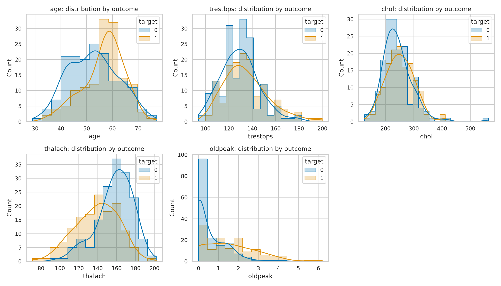
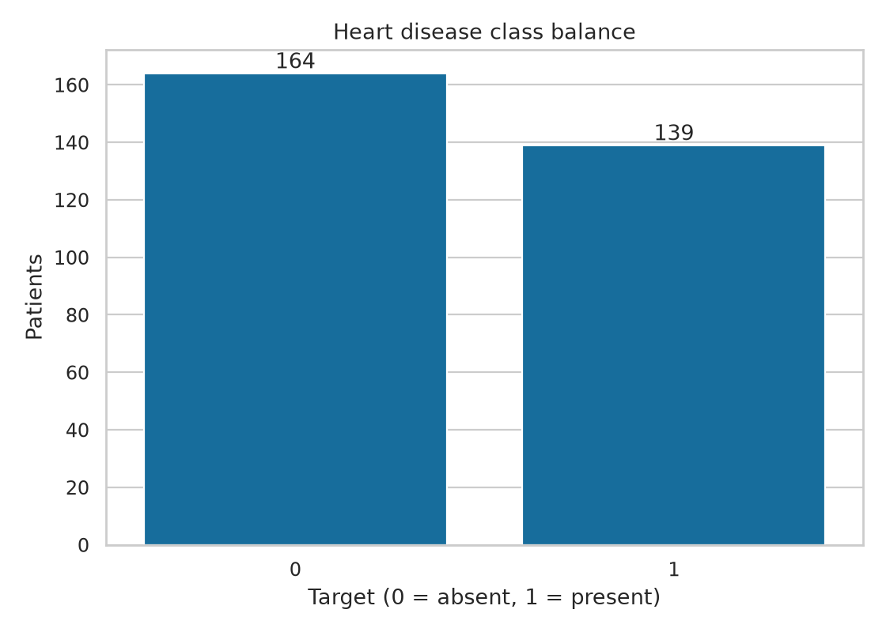
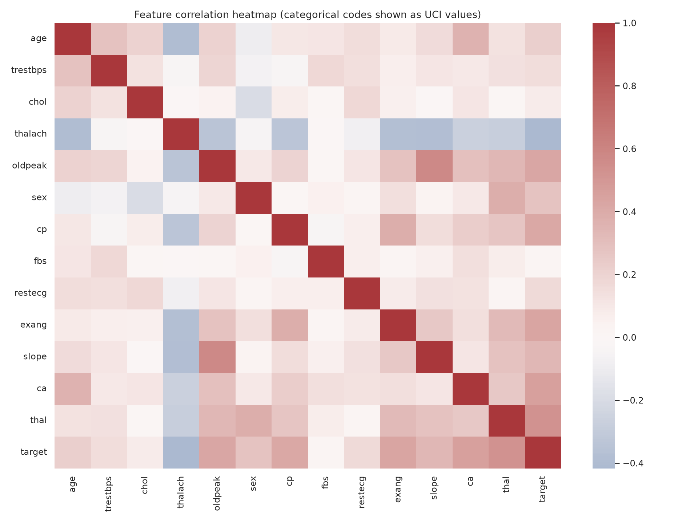

The classes are not assumed to be balanced. Accuracy is therefore reported alongside precision, recall, and ROC-AUC. Imputation is performed inside cross-validation, preventing validation-fold information from entering the preprocessing fit.

## 3. Features and preprocessing

The 13 input columns follow the UCI names and codes. Numeric measures (`age`, `trestbps`, `chol`, `thalach`, `oldpeak`) use median imputation and standardization. Coded features (`sex`, `cp`, `fbs`, `restecg`, `exang`, `slope`, `ca`, `thal`) use most-frequent imputation and one-hot encoding with unseen categories ignored at prediction. Each transformer is in the serialized scikit-learn `Pipeline`; inference uses the exact fitted transformations and feature names used in training.

The API validates required fields and simple physiological/code bounds, rejects extra fields, and identifies the output as a model score rather than medical advice. Training/serving schemas are defined once in `src.features.FEATURE_NAMES` and represented by the Pydantic API model.

## 4. Models and selection

The compared estimators are Logistic Regression and a class-weighted Random Forest. For each, the experiment includes a fixed baseline and a training-only `GridSearchCV` variant. Logistic Regression tests regularization values `C = 0.1, 1, 10`; Random Forest tests three maximum-depth values and three minimum-leaf values while fixing the tree count and random seed. The training partition is evaluated with shuffled five-fold stratified cross-validation. A separate stratified 20% holdout set is not used for hyperparameter selection.

The selected candidate is the one with the highest mean five-fold training ROC-AUC. The selected estimator is refitted on the training partition, and the holdout scores are reported as an estimate of generalization, not used to choose the winner. The actual score table, including accuracy, precision, recall, ROC-AUC, and tuning results for every candidate, is in `artifacts/training_summary.json`. Each run also produces a ROC curve and holdout confusion matrix.

**Measured results:**

```json
{
  "runs": [
    {
      "run_name": "random_forest_tuned",
      "cv_mean": {
        "accuracy": 0.8014455782312926,
        "precision": 0.7877761069340016,
        "recall": 0.7826086956521738,
        "roc_auc": 0.9033912142607795
      },
      "holdout": {
        "accuracy": 0.8688524590163934,
        "precision": 0.8125,
        "recall": 0.9285714285714286,
        "roc_auc": 0.9567099567099567
      },
      "tuning": {
        "best_params": {
          "classifier__max_depth": 5,
          "classifier__min_samples_leaf": 4
        }
      }
    },
    {
      "run_name": "logistic_regression_baseline",
      "cv_mean": {
        "accuracy": 0.8471088435374149,
        "precision": 0.8767529146045769,
        "recall": 0.783399209486166,
        "roc_auc": 0.9024931590148981
      },
      "holdout": {
        "accuracy": 0.8852459016393442,
        "precision": 0.8387096774193549,
        "recall": 0.9285714285714286,
        "roc_auc": 0.9664502164502166
      },
      "tuning": {
        "tuned": false
      }
    },
    {
      "run_name": "logistic_regression_tuned",
      "cv_mean": {
        "accuracy": 0.8471088435374149,
        "precision": 0.8767529146045769,
        "recall": 0.783399209486166,
        "roc_auc": 0.9024931590148981
      },
      "holdout": {
        "accuracy": 0.8852459016393442,
        "precision": 0.8387096774193549,
        "recall": 0.9285714285714286,
        "roc_auc": 0.9664502164502166
      },
      "tuning": {
        "best_params": {
          "classifier__C": 1.0
        }
      }
    },
    {
      "run_name": "random_forest_baseline",
      "cv_mean": {
        "accuracy": 0.8016156462585033,
        "precision": 0.7788378288378289,
        "recall": 0.800790513833992,
        "roc_auc": 0.8985113115547897
      },
      "holdout": {
        "accuracy": 0.8852459016393442,
        "precision": 0.8181818181818182,
        "recall": 0.9642857142857143,
        "roc_auc": 0.9464285714285714
      },
      "tuning": {
        "tuned": false
      }
    }
  ]
}
```

## 5. Experiment tracking and packaging

The MLflow experiment is named `heart-disease-uci` and is stored in a local SQLite database. Each of four candidate runs logs a run name, estimator and tuning parameters, fixed split/seed configuration, mean cross-validation metrics, holdout metrics, an ROC/confusion-matrix figure, and the fitted scikit-learn pipeline artifact. The final `training-summary` run logs the summary JSON. Start the local UI with:

```powershell
python -m mlflow ui --backend-store-uri sqlite:///./mlflow.db --host 127.0.0.1 --port 5000
```

The chosen end-to-end model is stored at `models/heart_disease.joblib`; `artifacts/training_summary.json` records the selected run, data split, metric, and local MLflow URI. Regenerate with `python -m src.train`. The lockstep of preprocessing and estimator in one artifact reduces training-serving skew. The assignment's dependency manifest is `requirements.txt`; the API image uses the smaller `requirements-api.txt`.

**MLflow evidence:**

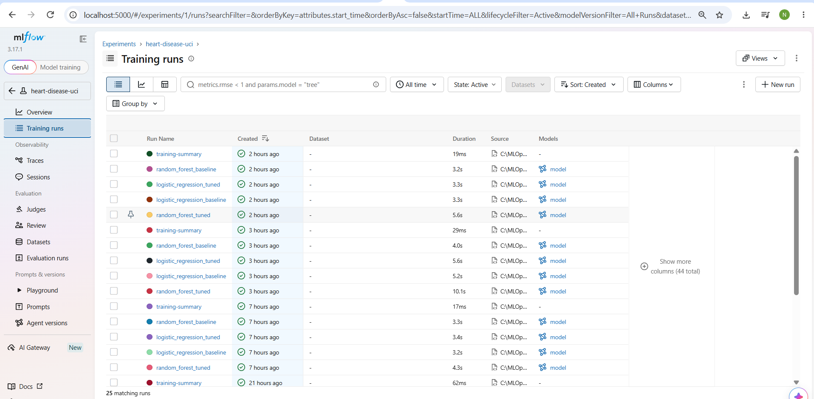

(For other model specific screenshots refer screenshots/README.md)

## 6. Service, logging, and monitoring

FastAPI exposes `GET /health`, `POST /predict`, and `GET /metrics`, and interactive OpenAPI docs at `/docs`. The prediction response contains `prediction`, a readable `label`, `confidence` for the predicted class, and `risk_probability` for class 1. The educational output must not be interpreted as a clinical probability.

The HTTP middleware logs method, path, status, and elapsed time, but never logs request bodies. `/metrics` returns Prometheus text counters by path and status. Docker Compose starts Prometheus and Grafana, provisions a Prometheus datasource, and loads a dashboard for API scrape health, request totals, and per-path/status request rate. `kubectl apply -k k8s` provisions the corresponding local Kubernetes stack, including scrape configuration, datasource, dashboard, and internal monitoring services. `scripts/verify_deployment.ps1` checks API health, sample inference, Prometheus target health, and Grafana health. Health probes, CPU/memory requests and limits, non-root execution, dropped capabilities, and read-only container root filesystems are included in the Kubernetes workloads.

**Verified local run:** Docker Compose integration checks passed for container health, sample prediction, Prometheus target status `UP`, Grafana health, and dashboard provisioning. The same checks passed in an isolated Docker Desktop Kubernetes namespace with two API replicas, Prometheus, and Grafana ready. The local API LoadBalancer had no external IP, so Kubernetes checks used port-forward. The temporary test deployments were removed afterward; no screenshots were captured automatically.

**Observed sample request/response:**

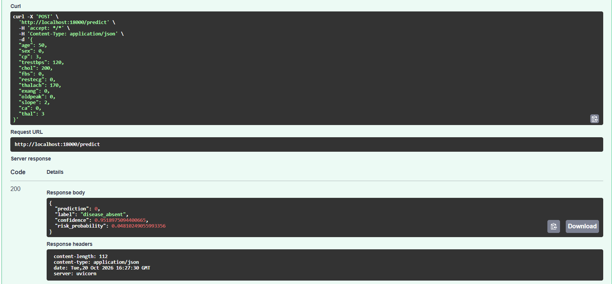

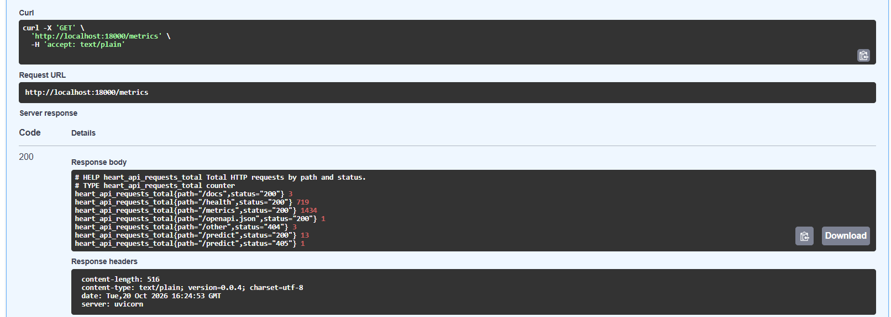

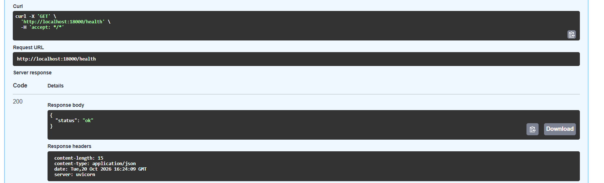

**Monitoring evidence:**

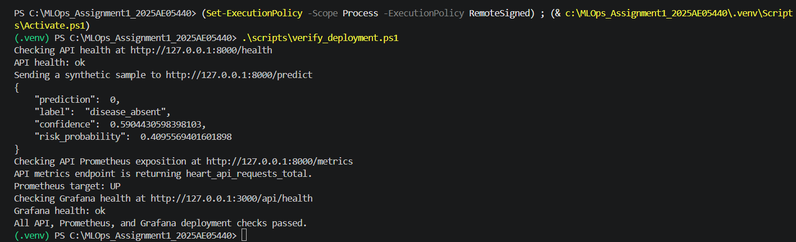


## 7. Testing, CI/CD, and containerization

Pytest covers missing-value/target cleaning, schema validation, pipeline fitting and probability output, health/prediction responses, request metrics, and API input validation. Ruff checks lint and imports. The GitHub Actions workflow runs on push, pull request, and manual dispatch across Python 3.11 and 3.12, installs the documented dependencies, runs lint/tests, downloads data, creates EDA, trains/tracks models, and uploads workflow artifacts even if a later step fails.

The multi-stage Docker build creates the final model in its builder stage, then places the API and model in a Python 3.12 runtime image. The final process runs unprivileged. Docker Compose adds the API, Prometheus, and Grafana, with loopback-only ports, persisted monitoring state, and read-only API filesystem/capability restrictions. The Docker Compose integration was run successfully. Reproduce with `docker compose up --build -d`, sample API requests, and `scripts/verify_deployment.ps1`.

**CI run URL/status:** https://github.com/nivedha2702/MLOps_Assignment1_2025AE05440/actions/runs/39410765123 (example jobs completed)

**Docker build/run evidence:**

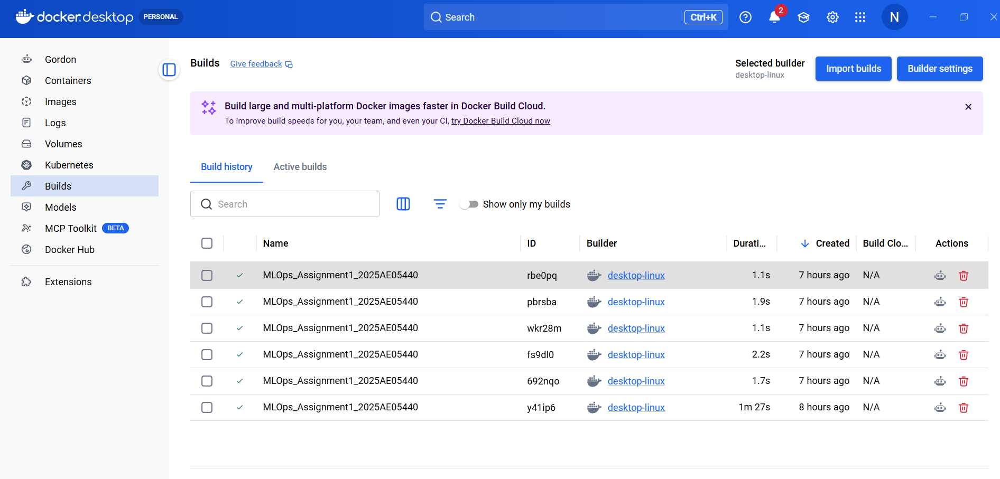
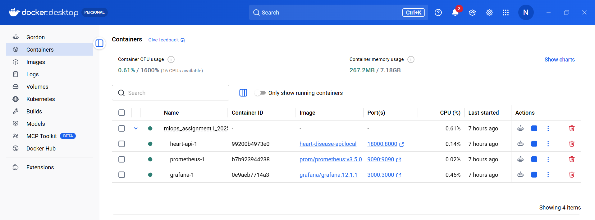
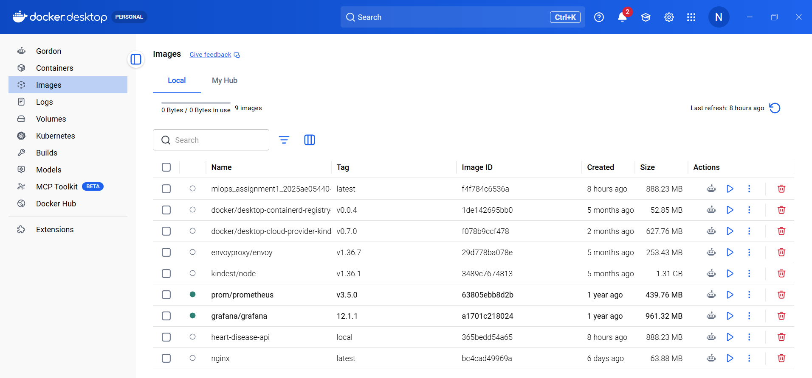

## 8. Deployment and reproducibility

`k8s/deployment.yaml` defines two API replicas, probes, resource bounds, non-root security context, a `LoadBalancer` Service, and Prometheus scrape annotations. `k8s/monitoring-stack.yaml` adds Prometheus and Grafana; `k8s/kustomization.yaml` generates their configuration, datasource, and dashboard. The Docker Desktop Kubernetes deployment was rolled out and checked successfully. Its local Service external IP remained pending; verification used port-forward. For a repeat deployment, create the local Grafana admin Secret with `scripts/create_grafana_secret.ps1`, apply `kubectl apply -k k8s`, wait for all rollouts, then port-forward the API and monitoring services. For cleanup, `scripts/cleanup_local_k8s.ps1` removes only the assignment namespace and safely handles an unallocated local LoadBalancer finalizer. For Minikube, load the built image first and use port-forward or its service tunnel. A public cloud address requires your own account, image registry, and provider network/security configuration.
**Deployment screenshot:**

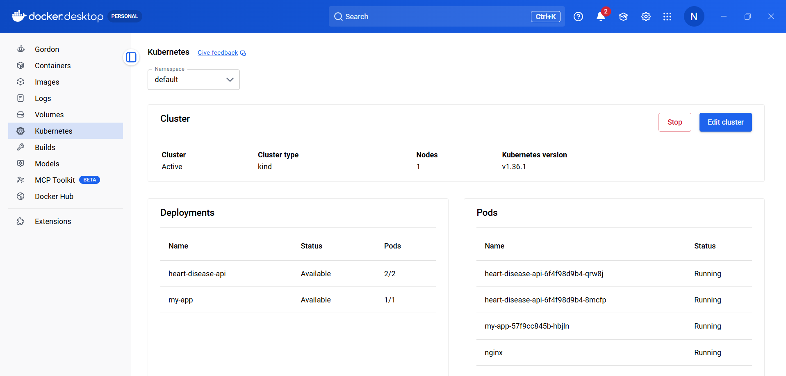

## 9. Architecture and runbook

```text
UCI source -> explicit cleaner -> EDA -> train-only impute/scale/encode
    -> four CV/tuning MLflow runs -> selected pipeline + metrics report
    -> Docker builder trains model -> non-root FastAPI image
    -> Kubernetes Deployment/Service -> API request logs and metrics
    -> Prometheus scrape -> provisioned Grafana dashboard
GitHub Actions -> Ruff -> Pytest -> data/EDA/train -> uploaded artifacts
```

From a clean Python 3.11/3.12 environment, install `requirements.txt`, run `python -m src.data`, `python -m src.eda`, `python -m src.train`, `python -m pytest`, and `python -m ruff check .`. A full PowerShell walkthrough and sample JSON are in `README.md`. Container execution performs its own training in the builder stage. Container/Kubernetes build requires working network access to download the dataset and Python packages.

## 10. Limitations, evidence, and conclusion

The source contains few observations, is historical, and is not a current, representative or validated clinical cohort. Feature codes and target conventions are dataset-specific; the train/test estimate has sampling uncertainty, and cross-validation on a small sample may vary across seeds. An observational prediction does not establish causality, and group fairness, calibration, prospective validation, data shift, privacy, and regulatory requirements are beyond the scope of this assignment. Clinical use would require appropriate expert governance and independent validation.

The evidence submitted should include this customized report, repository URL, EDA/training outputs, four-run MLflow screenshot, test/CI results, Docker build and API test, Kubernetes status/API test, Grafana dashboard and Prometheus target evidence, and a short student-recorded pipeline walkthrough video. The supplied screenshots are in `screenshots/` and linked below; confirm they match the final lab run before submission. See `screenshots/README.md` for the evidence index. Keep screenshots, logs, and repository content free of credentials and real patient data.

**Repository:** https://github.com/nivedha2702/MLOps_Assignment1_2025AE05440

**Video:** https://drive.google.com/file/d/1KOa0a9o1VXUELr5gCvgzY5pRGTGOGkp4/view?usp=sharing
